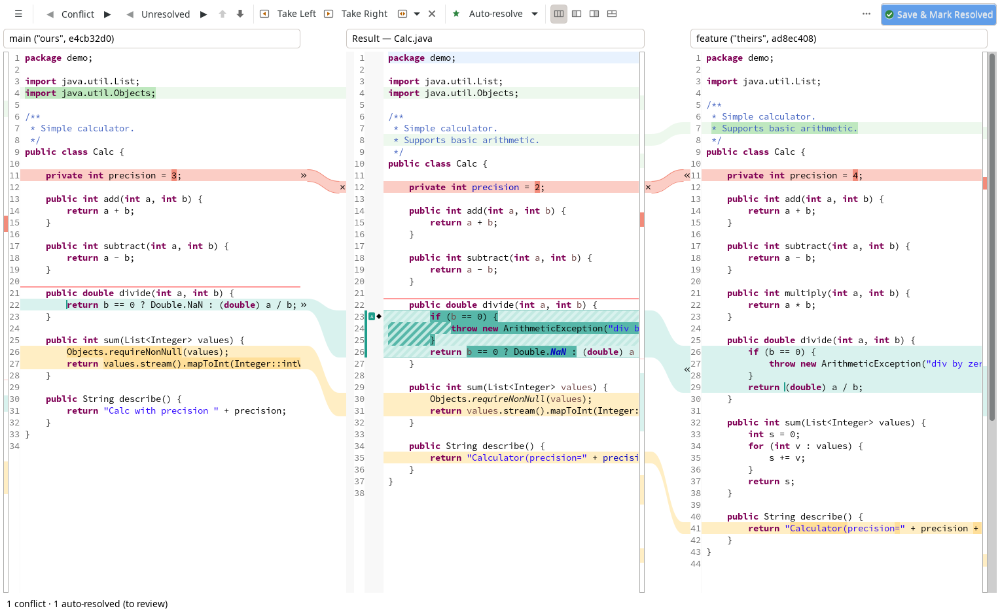
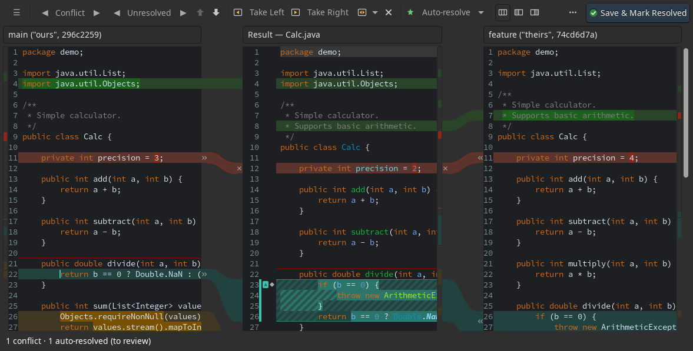
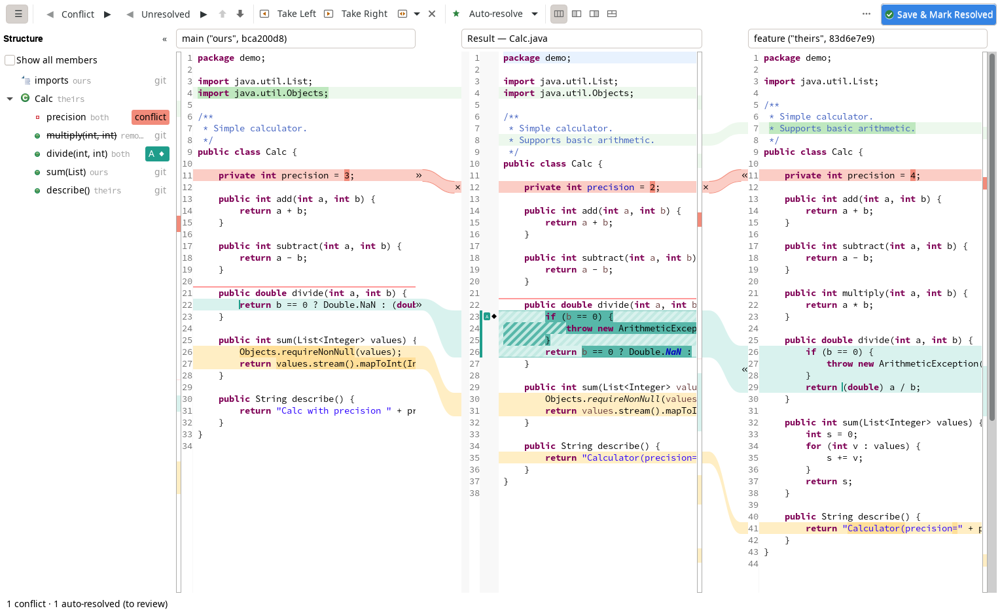

# AfterGit Merge Resolver

AfterGit is a three-pane git conflict resolver for the Eclipse IDE. It plugs into EGit: a double-click on a
conflicting file in Git Staging opens ours, the result and theirs side by side, resolves what can be resolved
safely on its own, and leaves every automatic decision visible until you review it.

Website: <https://slavus.github.io/aftergit/> · Eclipse update site: `https://slavus.github.io/aftergit/updates/`

> Status: 0.0.1 is the first public release. It is used on real merges but is young; review the result before you
> commit. Open items and known limitations are listed in [CHANGELOG.md](CHANGELOG.md) and
> [docs/open-items.md](docs/open-items.md).

## Features

- **Three panes with connectors.** Ours | Result | Theirs (or Left + Result, Result + Right, Result Below), full-line
  change colours with the changed words in a stronger shade, an overview stripe, one shared scroll bar. » / « take a
  side (Ctrl+click replaces), × ignores; Take Both, Revert Block and undo/redo that includes block states.
- **Auto-resolution on open.** Non-conflicting changes, word-level merges and an optional greedy pass, with the
  same switches in the resolver and in Preferences. Auto-resolved blocks are teal with an "A" and stay hatched until
  you mark them reviewed; Revert and Re-run take them back.
- **Structure-aware resolvers.** Java imports and Java class members (methods, fields, nested types, enum
  constants), `.properties` files per key, `MANIFEST.MF` per header and clause, and "Newer version wins" for build
  descriptors such as `pom.xml`, `feature.xml` and `*.target` (off by default). Other plug-ins can add resolvers
  through the extension point `net.aftergit.merge.resolvers`.
- **Java support** (with JDT). The result is a real Java editor with live errors, quick fix and content assist;
  imports are fixed after a take; an auto-resolved block that adds a compile error neither side had gets a red frame.
- **Resolve All Simple Conflicts** for files, folders, projects or a whole repository, in the background, with a
  summary, "Stage Resolved Files" and "Undo Resolve All".
- **Every kind of conflict.** Text conflicts in the resolver; binary and modify/delete conflicts with Keep Ours, Keep
  Theirs or Delete File; submodules, symbolic links and renames go to EGit's Merge Tool. Saving with open conflicts
  writes markers in the repository's `merge.conflictStyle`.
- **Structure compare.** A Structure column (and the Outline view) lists the members ours or theirs changed, who
  changed them and the state of their blocks, for Java, `.properties` and `MANIFEST.MF`.
- **Other languages** (with tm4e and lsp4e). TextMate syntax colours in all three panes, and the errors of the file's
  language server (Wild Web Developer, LemMinX and others) in the result.
- **Fits into EGit.** Optionally the Merge Tool of Git Staging, "Resolve in AfterGit…" in the explorers and the Team
  menu, Save & Mark Resolved (save, `git add`, close), markers on files that still need attention.
- **Preferences.** Workspace and project settings (shareable through `.settings`), colour schemes for light and dark
  themes including a colour-blind safe and a high-contrast one, and key bindings for every command.
- **Optional AI, off by default.** Two separate features that AfterGit works fine without:
  - *Resolve with AI* asks a language model (the Anthropic Messages API, or an OpenAI-compatible server such as
    OpenAI, Ollama or LM Studio) to resolve a conflict. Nothing is sent until you allow it; a server off this
    computer asks for consent; the key stays in Eclipse secure storage.
  - *AI agents (MCP)* runs a local Model Context Protocol server (127.0.0.1 only, with a token) through which agents
    you run yourself read the conflicts and propose resolutions.

  In both, every answer is a proposal shown as a purple ✨ block that you review; nothing saves or stages a file.

| Dark theme | Structure column |
|---|---|
|  |  |

## Requirements

- Eclipse IDE 2026-03 (4.39) or later, running on Java 21 or later.
- EGit and JGit 7.6 or later (part of the Eclipse IDE packages).
- Optional: the Java development tools (JDT) for the Java support; TextMate support (tm4e 0.17.2 or later) and the
  Language Server Protocol client (lsp4e 0.19.8 or later) for other languages.
- Tested on Linux (GTK). The bundles are plain Java and SWT, but Windows and macOS are not tested yet.

## Install

From the update site:

1. In Eclipse: Help → Install New Software… → Add… and enter the location
   `https://slavus.github.io/aftergit/updates/` (it offers every release; `updates/<version>/` holds one release).
2. Select "AfterGit Merge Resolver" (the Java support and Languages parts install with it when their prerequisites
   are present), and optionally "AI Agents (MCP)" and "Resolve with AI". Finish, trust the unsigned AfterGit
   content and restart.

Offline, from a release: download `aftergit-<version>-site.zip` from the
[releases](https://github.com/slavus/aftergit/releases) and use Add… → Archive… with the zip instead.
The [install guide](https://slavus.github.io/aftergit/install.html) on the website has the details, including
update and uninstall.

From a local build, use Add… → Local… → `releng/net.aftergit.merge.site/target/repository` instead.

Then double-click a conflicting file in Git Staging, or right-click a conflicted file → "Resolve in AfterGit…".
The full user guide is [docs/INSTALL.md](docs/INSTALL.md).

## Build from source

Requirements: JDK 21 or later, Maven 3.9 or later, git (some tests compare with `git merge-file`).

    mvn clean verify

The target platform (`releng/aftergit-p2.target`) is resolved from download.eclipse.org: Eclipse 2026-03 with EGit,
JGit, JDT, tm4e, lsp4e and Wild Web Developer. The update site lands in
`releng/net.aftergit.merge.site/target/repository`.

To build against an Eclipse IDE 2026-03 you have installed instead (no download of the target platform), pass its
location; it selects `releng/aftergit.target`:

    mvn clean verify -Daftergit.eclipse.home=/path/to/eclipse

The option can be kept in `.mvn/maven.config`, which git ignores.

UI tests run on a virtual X display (needs `Xvfb`), never on your desktop:

    AFTERGIT_XVFB_DISPLAY=97 releng/ui-tests.sh

More in [docs/testing.md](docs/testing.md). The design documents are in `docs/design`.

The website sources are in `site/`. `releng/publish-site.sh` lays out the website and the update site in a checkout
of the `gh-pages` branch; the release workflow runs it for every `v*` tag, and the website workflow refreshes the
pages when `site/` changes on `main`.

## License

AfterGit is licensed under the [Eclipse Public License 2.0](LICENSE) (`EPL-2.0`). Parts of the merge core are
derived from [IntelliJ Community](https://github.com/JetBrains/intellij-community) and stay under the Apache License,
Version 2.0; see [NOTICE](NOTICE).
